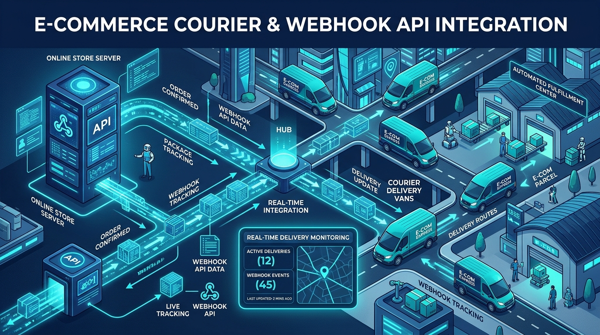
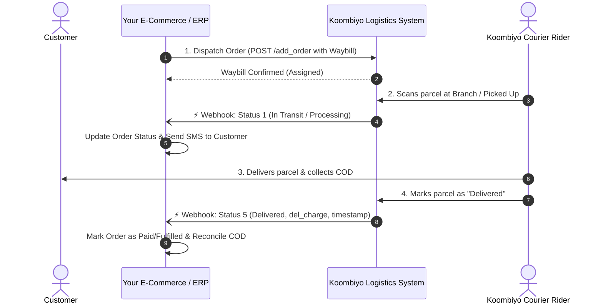
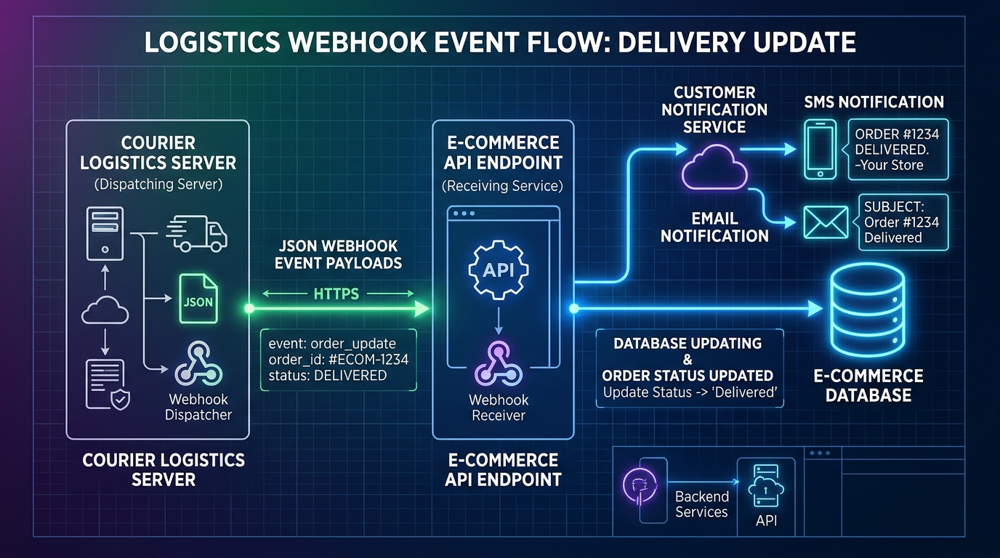

# Building Real-Time Delivery Tracking with Koombiyo Webhooks: A Complete Implementation Guide

> *Say goodbye to inefficient API polling. Learn how to configure, secure, and handle automated delivery status callbacks from Sri Lanka’s premier courier logistics network.*

---



Managing courier logistics is one of the most critical aspects of running an e-commerce platform or ERP in Sri Lanka. Customers demand real-time visibility on their packages, finance teams require instant Cash on Delivery (COD) reconciliation, and warehouse managers need to track pending returns without manual intervention.

Traditionally, developers relied on **cron jobs and scheduled polling**—repeatedly calling an API every few minutes to check whether order `#ORD-99812` was delivered or returned. This approach creates high server load, wastes API rate limits, causes delay in status updates, and strains network resources.

The modern solution? **Event-driven Webhooks**.

In this guide, we will walk step-by-step through integrating **Koombiyo Delivery’s status management webhooks** into your application. We will cover configuration in the Koombiyo Client Portal, dissect the payload schema, build an enterprise-ready receiver in **Laravel/PHP** and **Node.js**, and implement best practices such as idempotency and asynchronous queue processing.

---

## 1. How Koombiyo Webhooks Work

A **webhook** (also known as a reverse API or web callback) reverses the communication flow. Instead of your server constantly querying Koombiyo for parcel updates, Koombiyo’s logistics server automatically issues an HTTP `POST` request directly to your configured endpoint whenever a package status transitions in their internal network.

### The Delivery Event Lifecycle



### Event Triggers

Koombiyo pushes an event whenever any of the following milestones take place:
- **Pickup & Sorting**: Order accepted at sorting hub or branch.
- **In Transit**: Parcel moving between logistics centers.
- **Out for Delivery**: Handed over to the delivery rider for last-mile drop-off.
- **Delivered**: Parcel handed to the customer, COD collected (Status `5`).
- **Rescheduled / Attempted**: Customer unreachable or requested alternate date.
- **Pending Return / Return Received**: Delivery failed after maximum attempts and returned to merchant (Status `9` / `15`).

---

## 2. Setting Up Your Webhook in the Koombiyo Portal

Before writing code, you need to configure your webhook endpoint in the Koombiyo Merchant Portal.

### Step 1: Access Portal Settings
1. Navigate to the **Koombiyo Client Portal**: [`https://client.koombiyodelivery.lk`](https://client.koombiyodelivery.lk).
2. Log in with your registered merchant credentials.
3. In the left-hand navigation sidebar, click your account name and open **Settings** (or click the Settings icon in the top header).

### Step 2: Configure the Webhook URL
On the Settings dashboard, you will locate the **Webhook URL** card adjacent to your **API Key** settings:


1. Click the **Update URL** button.
2. Enter your live, publicly accessible HTTPS webhook endpoint:
   ```text
   https://yourdomain.com/api/webhooks/koombiyo
   ```
   *(For local testing in development, use an **ngrok** or **Cloudflare Tunnel** URL, such as `https://xxxx.ngrok-free.app/api/webhooks/koombiyo`).*
3. Save your changes.

### Step 3: Utilize the "Trigger Webhook Test" Console
The Koombiyo portal includes a built-in webhook testing utility directly below the API settings. You can trigger simulated events with custom waybills, statuses, delivery charges, and weights to confirm your server responds with an HTTP `200 OK`.

---

## 3. Dissecting the Koombiyo Webhook Payload

When an event occurs, Koombiyo sends an HTTP `POST` request with `Content-Type: application/json`.

### Payload Schema

```json
{
  "waybill_id": "102938475",
  "status_id": "5",
  "status": "Delivered",
  "weight": "1.25",
  "status_date": "2026-10-26 14:32:00",
  "del_charge": "350.00",
  "reason": "Delivered to customer"
}
```

### Field Reference Table

| Field | Type | Description | Example |
| :--- | :--- | :--- | :--- |
| `waybill_id` | `string` | The unique tracking waybill barcode number assigned to the parcel. | `"102938475"` |
| `status_id` | `string`/`int` | Numeric identifier representing the operational status. | `"5"` |
| `status` | `string` | Human-readable status description. | `"Delivered"` |
| `weight` | `string`/`float` | Actual parcel weight recorded by the branch scale in kilograms. | `"1.25"` |
| `status_date` | `string` | Timestamp when the status occurred (`YYYY-MM-DD HH:mm:ss`). | `"2026-10-26 14:32:00"` |
| `del_charge` | `string`/`float` | Delivery fee charged for this shipment in LKR. | `"350.00"` |
| `reason` | `string`/`null` | Specific note, e.g. customer reschedule reason or cancellation note. | `"Customer rescheduled"` |

### Critical Requirement: HTTP 200 Acknowledgment
> **Important**: Your webhook receiver **MUST** return an HTTP status code `200 OK` upon receiving the payload. Any non-200 response (such as `500 Internal Server Error`, `404 Not Found`, or a network timeout) will cause Koombiyo's dispatcher to treat the delivery as failed and trigger automatic retry schedules.

---

## 4. Architecture: Handling Webhooks with Resilience

Handling webhooks in production requires more than simply receiving a payload and running synchronous database updates. If your database is under load or third-party SMS gateways lag, your endpoint will fail to return an immediate HTTP 200, prompting unnecessary retries.



### Enterprise Design Patterns:
1. **Immediate Acknowledgment**: Return HTTP 200 within `< 200ms`.
2. **Asynchronous Processing**: Offload DB updates, email dispatches, and SMS notifications to a background queue (e.g., Redis / Laravel Queues).
3. **Idempotency**: Prevent duplicate updates if the same event is received multiple times.
4. **Out-of-Order Protection**: Compare `status_date` against existing logs to avoid overwriting a newer status with an older re-delivered webhook.

---

## 5. Implementation in Laravel (PHP)

Here is a clean, production-grade implementation for Laravel applications.

### 1. Define the Route (`routes/api.php`)

```php
use App\Http\Controllers\Webhooks\KoombiyoWebhookController;
use Illuminate\Support\Facades\Route;

Route::post('/webhooks/koombiyo', [KoombiyoWebhookController::class, 'handle'])
    ->name('webhooks.koombiyo');
```

> **Note**: API routes in Laravel (`routes/api.php`) are stateless and bypass CSRF protection by default. If you place the endpoint under `routes/web.php`, remember to exempt it in `bootstrap/app.php` or `App\Http\Middleware\VerifyCsrfToken`.

---

### 2. Create the Webhook Controller

Generate the controller via Artisan:
```bash
php artisan make:controller Webhooks/KoombiyoWebhookController
```

Implement the controller logic with validation and queued job dispatching:

```php
namespace App\Http\Controllers\Webhooks;

use App\Http\Controllers\Controller;
use App\Jobs\ProcessKoombiyoWebhookJob;
use Illuminate\Http\JsonResponse;
use Illuminate\Http\Request;
use Illuminate\Support\Facades\Log;
use Illuminate\Support\Facades\Validator;

class KoombiyoWebhookController extends Controller
{
    /**
     * Handle incoming Koombiyo webhook notifications.
     */
    public function handle(Request $request): JsonResponse
    {
        Log::channel('daily')->info('Koombiyo Webhook Received:', $request->all());

        // 1. Validate payload
        $validator = Validator::make($request->all(), [
            'waybill_id'  => 'required|string',
            'status_id'   => 'required',
            'status'      => 'required|string',
            'status_date' => 'required|date_format:Y-m-d H:i:s',
            'del_charge'  => 'nullable',
            'weight'      => 'nullable',
            'reason'      => 'nullable|string',
        ]);

        if ($validator->fails()) {
            Log::warning('Koombiyo Webhook Validation Failed', [
                'errors'  => $validator->errors()->toArray(),
                'payload' => $request->all()
            ]);
            // Still respond with 200 or 422 depending on error policies
            return response()->json(['status' => 'error', 'message' => 'Invalid payload format'], 422);
        }

        $payload = $validator->validated();

        // 2. Dispatch to background queue for non-blocking processing
        ProcessKoombiyoWebhookJob::dispatch($payload);

        // 3. Immediately respond with HTTP 200 OK
        return response()->json([
            'status'  => 'success',
            'message' => 'Webhook received successfully'
        ], 200);
    }
}
```

---

### 3. Create the Queue Worker Job

```bash
php artisan make:job ProcessKoombiyoWebhookJob
```

```php
namespace App\Jobs;

use App\Models\Delivery;
use App\Models\Order;
use Illuminate\Bus\Queueable;
use Illuminate\Contracts\Queue\ShouldQueue;
use Illuminate\Foundation\Bus\Dispatchable;
use Illuminate\Queue\InteractsWithQueue;
use Illuminate\Queue\SerializesModels;
use Illuminate\Support\Facades\DB;
use Illuminate\Support\Facades\Log;

class ProcessKoombiyoWebhookJob implements ShouldQueue
{
    use Dispatchable, InteractsWithQueue, Queueable, SerializesModels;

    protected array $data;

    public function __construct(array $data)
    {
        $this->data = $data;
    }

    public function handle(): void
    {
        $waybillId  = $this->data['waybill_id'];
        $statusId   = (int)$this->data['status_id'];
        $statusName = $this->data['status'];
        $statusDate = $this->data['status_date'];
        $delCharge  = isset($this->data['del_charge']) ? (float)$this->data['del_charge'] : 0.0;
        $weight     = isset($this->data['weight']) ? (float)$this->data['weight'] : null;
        $reason     = $this->data['reason'] ?? null;

        DB::transaction(function () use ($waybillId, $statusId, $statusName, $statusDate, $delCharge, $weight, $reason) {
            // Find shipment by waybill ID
            $delivery = Delivery::where('waybill_id', $waybillId)->first();

            if (!$delivery) {
                Log::warning("Koombiyo Webhook: Delivery with waybill #{$waybillId} not found in database.");
                return;
            }

            // Guard against out-of-order events
            if ($delivery->last_status_date && $delivery->last_status_date > $statusDate) {
                Log::info("Koombiyo Webhook: Ignored older status event for waybill #{$waybillId}.");
                return;
            }

            // Update delivery record
            $delivery->update([
                'status_id'        => $statusId,
                'status_name'      => $statusName,
                'last_status_date' => $statusDate,
                'delivery_charge'  => $delCharge,
                'actual_weight'    => $weight ?? $delivery->actual_weight,
                'status_reason'    => $reason,
            ]);

            // Sync with parent Order
            $order = $delivery->order;
            if ($order) {
                $this->mapOrderStatus($order, $statusId, $statusName);
            }

            Log::info("Koombiyo Webhook: Successfully processed waybill #{$waybillId} -> Status: {$statusName}");
        });
    }

    /**
     * Map Koombiyo delivery status to internal business state.
     */
    protected function mapOrderStatus(Order $order, int $statusId, string $statusName): void
    {
        switch ($statusId) {
            case 5: // Delivered
                $order->update([
                    'delivery_status' => 'delivered',
                    'payment_status'  => 'paid', // If COD, mark paid upon delivery
                    'delivered_at'    => now(),
                ]);
                // Trigger customer SMS / WhatsApp notification
                break;

            case 9: // Pending Return
                $order->update([
                    'delivery_status' => 'return_in_transit',
                ]);
                break;

            case 15: // Return Received at Merchant Store
                $order->update([
                    'delivery_status' => 'returned',
                    'payment_status'  => 'cancelled_or_refunded',
                ]);
                break;

            default:
                $order->update([
                    'delivery_status' => strtolower(str_replace(' ', '_', $statusName)),
                ]);
                break;
        }
    }
}
```

---

## 6. Implementation in Node.js (Express)

For teams building on Node.js/TypeScript microservices, here is the Express equivalent:

```javascript
import express from 'express';

const router = express.Router();

router.post('/webhooks/koombiyo', async (req, res) => {
  const { waybill_id, status_id, status, status_date, del_charge, weight, reason } = req.body;

  // Validate presence of core fields
  if (!waybill_id || !status_id || !status_date) {
    return res.status(400).json({ error: 'Missing required webhook fields' });
  }

  // 1. Immediately acknowledge Koombiyo servers
  res.status(200).json({ status: 'ok', message: 'Event acknowledged' });

  // 2. Asynchronous background processing
  setImmediate(async () => {
    try {
      console.log(`[Koombiyo Webhook] Updating Waybill ${waybill_id} to ${status} (${status_id})`);
      
      // Update Database Record
      await updateShipmentRecord({
        waybill_id,
        status_id: Number(status_id),
        status,
        status_date,
        del_charge: parseFloat(del_charge || '0'),
        weight: weight ? parseFloat(weight) : undefined,
        reason,
      });

    } catch (err) {
      console.error(`[Koombiyo Webhook Error] Failed to process waybill ${waybill_id}:`, err);
    }
  });
});

export default router;
```

---

## 7. Testing Your Webhook Locally

Testing webhooks on `localhost` can be challenging because Koombiyo’s cloud servers cannot reach `http://localhost:8000`. Here is the recommended development workflow:

### Step 1: Tunnel Localhost with Ngrok
Run ngrok in your terminal:
```bash
ngrok http 8000
```
This generates a secure forwarding URL such as `https://4a21-112-134-21-4.ngrok-free.app`.

### Step 2: Use the Koombiyo Developer API to Send Test Events
You can trigger a real HTTP probe using Koombiyo’s `/test_webhook` endpoint:

```bash
curl -X POST "https://client.koombiyodelivery.lk/clientapi/v2/test_webhook" \
  -H "Authorization: Bearer YOUR_ACCESS_TOKEN" \
  -H "Target-Webhook-URL: https://4a21-112-134-21-4.ngrok-free.app/api/webhooks/koombiyo" \
  -H "Content-Type: application/json" \
  -d '{
    "waybill_id": "102938475",
    "status_id": "5",
    "status": "Delivered",
    "weight": "1.0",
    "status_date": "2026-10-26 14:32:00",
    "del_charge": "350.00",
    "reason": "Customer received successfully"
  }'
```

### Expected Response from Koombiyo
```json
{
  "client_status_code": 200,
  "client_response_body": "{\"status\":\"success\",\"message\":\"Webhook received successfully\"}",
  "target_url": "https://4a21-112-134-21-4.ngrok-free.app/api/webhooks/koombiyo"
}
```

If your server responds with `200`, you will see your terminal register the request and your database record update seamlessly!

---

## 8. Summary Checklist for Production

Before launching your Koombiyo webhook integration to production, verify each of these checklist items:

- [x] **Secure HTTPS**: Webhook URL is hosted on valid SSL/TLS (HTTPS).
- [x] **Sub-second Response**: Receiver responds with HTTP `200 OK` in under 300ms.
- [x] **CSRF Disabled**: Endpoint is exempted from CSRF token verification middleware.
- [x] **Idempotency Checked**: Handling duplicate webhooks does not double-count accounting balances or resend multiple SMS alerts.
- [x] **Timestamp Protection**: Out-of-sequence webhooks do not roll back newer order statuses.
- [x] **Logging Configured**: Incoming payloads are logged with rotation for easy audit trails during logistics disputes.

---

## Conclusion

Automating your delivery updates using Koombiyo’s Webhooks transforms your e-commerce operations. By eliminating heavy polling cycles, your store achieves near-instant status synchronization, faster customer notifications, and hassle-free COD tracking.

Whether you run an ERP, a custom WooCommerce setup, or a bespoke Laravel e-commerce store, implementing event-driven webhooks is the best architectural foundation for scale.

*Happy Coding & Fast Dispatches! 🚀*
