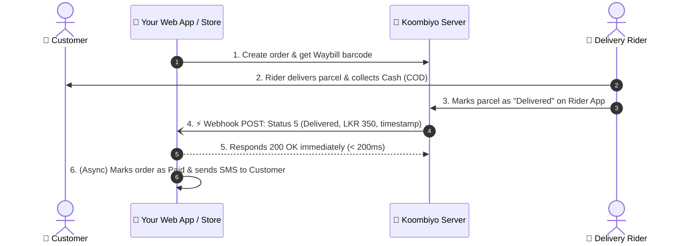
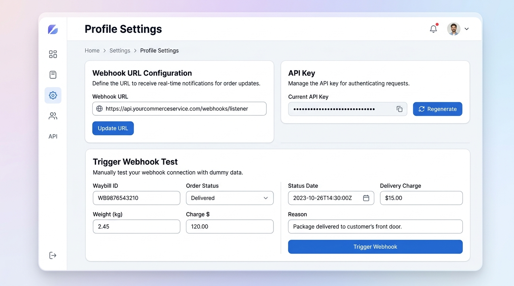

# Koombiyo Delivery Webhook Integration Guide & Starter Kits 🚚⚡

[](LICENSE)
[](examples/nodejs-express)
[](examples/php-vanilla)
[](examples/laravel)
[](README.md)

A complete, developer-friendly guide and ready-to-use starter code for integrating **Koombiyo Delivery’s real-time status webhooks** into your e-commerce platform, ERP, or custom backend.

Stop wasting server resources on inefficient cron job polling. Receive instant delivery and Cash-on-Delivery (COD) updates straight to your server.

---

> 🇱🇰 **සිංහල සටහන (Developer Note):**  
> Koombiyo Delivery හරහා packages deliver වන විට, status එක change වෙන හැම අවස්ථාවකදීම (Delivered, Out for Delivery, Return, etc.) Koombiyo server එකෙන් අපේ server එකේ webhook URL එකට POST request එකක් (JSON payload) එවනු ලබයි.  
> Cron jobs දාලා APIs repeatedly call (polling) කරනවා වෙනුවට මේ webhook එක භාවිතා කිරීමෙන් තත්පර ගණනකින් status update කරගත හැක.

---

## 📌 Table of Contents
1. [How It Works](#1-how-it-works)
2. [Configuring Webhook in Koombiyo Portal](#2-configuring-webhook-in-koombiyo-portal)
3. [Webhook Payload Schema](#3-webhook-payload-schema)
4. [Status Code Reference Table](#4-status-code-reference-table)
5. [Starter Code Examples](#5-starter-code-examples)
   - [Node.js (Express)](examples/nodejs-express)
   - [Vanilla PHP (Single File)](examples/php-vanilla)
   - [Laravel (Queued Controller & Job)](examples/laravel)
6. [Local Testing with Ngrok & cURL](#6-local-testing-with-ngrok--curl)
7. [Postman Collection](#7-postman-collection)
8. [Production Best Practices Checklist](#8-production-best-practices-checklist)
9. [Detailed Guide (Medium Article)](#9-detailed-guide-medium-article)

---

## 1. How It Works

Instead of your server polling Koombiyo every 15 minutes, Koombiyo automatically pushes an HTTP `POST` request to your webhook URL whenever a rider or warehouse updates a parcel's status:



---

## 2. Configuring Webhook in Koombiyo Portal

1. Log in to the **Koombiyo Client Portal**: [client.koombiyodelivery.lk](https://client.koombiyodelivery.lk).
2. Go to **Settings** (gear icon or user profile menu).
3. Find the **Webhook URL** card next to your API Keys.
4. Click **Update URL** and enter your public HTTPS endpoint:
   ```text
   https://yourdomain.com/api/webhooks/koombiyo
   ```
5. Save your settings.



> 💡 **Development Tip**: For testing on localhost, use **[ngrok](https://ngrok.com)** to generate a public HTTPS tunnel (e.g., `https://xxxx.ngrok-free.app/api/webhooks/koombiyo`).

---

## 3. Webhook Payload Schema

When a status changes, Koombiyo sends an HTTP `POST` request with `Content-Type: application/json`:

```json
{
  "waybill_id": "102938475",
  "status_id": "5",
  "status": "Delivered",
  "weight": "1.25",
  "status_date": "2026-10-26 14:32:00",
  "del_charge": "350.00",
  "reason": "Delivered to customer"
}
```

### Field Definitions

| Field | Type | Description | Example |
| :--- | :--- | :--- | :--- |
| `waybill_id` | `string` | The unique parcel tracking waybill number. | `"102938475"` |
| `status_id` | `string`/`int` | Numeric identifier of the delivery status. | `"5"` |
| `status` | `string` | Human-readable name of the status. | `"Delivered"` |
| `weight` | `string`/`float` | Actual parcel weight recorded by Koombiyo scale (kg). | `"1.25"` |
| `status_date` | `string` | Timestamp of the event (`YYYY-MM-DD HH:mm:ss`). | `"2026-10-26 14:32:00"` |
| `del_charge` | `string`/`float` | Delivery fee charged in LKR. | `"350.00"` |
| `reason` | `string`/`null` | Note or reason (e.g. customer reschedule, refusal note). | `"Customer rescheduled"` |

---

## 4. Status Code Reference Table

| Status ID | Status Name | Meaning | Recommended Action |
| :---: | :--- | :--- | :--- |
| **1** | Picked Up / Accepted | Parcel collected from merchant and accepted at branch | Update order to *Processing / Shipped* |
| **2** / **3** | In Transit | Parcel moving between distribution hubs | Update tracking timeline |
| **4** | Out for Delivery | Parcel assigned to rider for last-mile delivery | Send SMS to customer: *"Your order will arrive today"* |
| **5** | **Delivered** | Customer received parcel; COD collected | Mark order as **Delivered** & **Paid**; reconcile COD |
| **8** | Rescheduled / Note | Customer was unreachable or asked for another day | Log note; notify support team if repeated |
| **9** | Pending Return | Delivery failed after maximum attempts; being returned | Flag order as *Return in Transit* |
| **15** | Return Received | Parcel arrived back at merchant warehouse | Restock inventory; mark order as *Returned / Cancelled* |

---

## 5. Starter Code Examples

This repository includes plug-and-play boilerplate receivers:

### 🟢 1. [Node.js (Express)](examples/nodejs-express)
Ideal for Node.js / TypeScript microservices:
```bash
cd examples/nodejs-express
npm install
npm start
```
- Listens on `http://localhost:3000/api/webhooks/koombiyo`
- Fast `200 OK` response with asynchronous processing via `setImmediate()`
- Out-of-order date check & status mapping

### 🟣 2. [Vanilla PHP (Single File)](examples/php-vanilla)
Ideal for standard shared hosting, cPanel, or WordPress:
```bash
cd examples/php-vanilla
php -S localhost:8000
```
- Zero external dependencies.
- Copy `webhook.php` to your `public_html/` and you're live!

### 🔴 3. [Laravel (Controller + Job)](examples/laravel)
Production-grade queued implementation for Laravel 10 / 11+:
- `KoombiyoWebhookController.php`: validates payload & immediately responds `200 OK`.
- `ProcessKoombiyoWebhookJob.php`: handles database transaction, queue retries, and order status sync.

---

## 6. Local Testing with Ngrok & cURL

### Step 1: Start your local server
Run any of the examples (e.g., Node.js on port 3000 or PHP on port 8000).

### Step 2: Test using the included shell script
We provide a helper script [`test-webhook.sh`](test-webhook.sh) to send a realistic payload with a single command:

```bash
# Test Node.js example:
./test-webhook.sh http://localhost:3000/api/webhooks/koombiyo

# Test PHP example:
./test-webhook.sh http://localhost:8000/webhook.php
```

Or test using raw `curl`:
```bash
curl -X POST http://localhost:3000/api/webhooks/koombiyo \
  -H "Content-Type: application/json" \
  -d '{
    "waybill_id": "102938475",
    "status_id": "5",
    "status": "Delivered",
    "weight": "1.25",
    "status_date": "2026-10-26 14:32:00",
    "del_charge": "350.00",
    "reason": "Delivered to customer"
  }'
```

### Step 3: Tunnel with Ngrok
```bash
ngrok http 3000
```
Enter the resulting `https://...ngrok-free.app/api/webhooks/koombiyo` into your Koombiyo portal.

---

## 7. Postman Collection

Import [`postman/Koombiyo_Webhook_Collection.postman_collection.json`](postman/Koombiyo_Webhook_Collection.postman_collection.json) into Postman to instantly test all webhook status scenarios (Delivered, Out for Delivery, In Transit, Return, etc.).

---

## 8. Production Best Practices Checklist

When going live, make sure your integration meets these criteria:

- [x] **Always Respond with HTTP 200 OK**: Koombiyo considers any response other than `200` (such as `500`, `404`, or a timeout) as a failure and will retry.
- [x] **Sub-200ms Response Time**: Offload time-consuming tasks (sending emails, SMS, heavy DB queries) to background queues.
- [x] **Disable CSRF for the Webhook Route**: Ensure `/api/webhooks/koombiyo` is excluded from CSRF token verification middleware.
- [x] **Protect Against Out-of-Order Webhooks**: Check that the incoming `status_date` is newer than the current `last_status_date` stored in your database before applying the update.
- [x] **Idempotency**: Ensure that receiving the same status payload twice does not cause duplicate accounting entries or duplicate SMS notifications.
- [x] **Log Incoming Requests**: Store incoming payloads in a log file or database table with daily rotation to help troubleshoot delivery disputes.

---

## 9. Detailed Guide (Medium Article)

For an in-depth architectural breakdown, deep dive, and best practices, check out the full article:  
📖 **[Read the Full Medium Guide](KOOMBIYO_WEBHOOK_INTEGRATION_MEDIUM_ARTICLE.md)**

---

## 🤝 Contributing & Support
Contributions, issues, and feature requests are welcome!  
Feel free to open an issue or submit a pull request.

## 📄 License
This project is open-source under the [MIT License](LICENSE).
